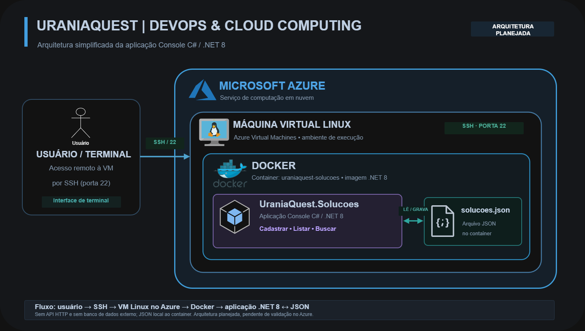

# UraniaQuest — DevOps & Cloud Computing | Sprint 1

**FIAP — Challenge 2026 | AMAZUL | Turma 2TDSPA**

## Sobre o projeto

O **UraniaQuest** é uma proposta de jogo educativo para mostrar aplicações da tecnologia nuclear na saúde, alimentação, energia, indústria e Amazônia Azul.

Nesta Sprint, usamos o módulo **UraniaQuest.Solucoes**, desenvolvido em **C# / .NET 8**. Ele é um programa de terminal que permite cadastrar, listar e buscar soluções científicas por categoria. Nosso objetivo em DevOps foi colocar essa aplicação em um **container Docker** e mostrar seu funcionamento em uma **máquina virtual Linux no Microsoft Azure**.

## O que a aplicação faz

- Cadastra soluções científicas com código, nome, categoria, problema, aplicação, instituição, referência e link.
- Lista os registros cadastrados.
- Busca soluções por categoria.
- Valida os campos e os links informados.
- Salva os dados no arquivo `solucoes.json`.

As categorias são `ALIMENTACAO`, `SAUDE`, `ENERGIA`, `INDUSTRIA` e `AMAZONIA_AZUL`.

## Tecnologias utilizadas

- **C# / .NET 8:** aplicação Console.
- **Docker:** criação da imagem e execução do container.
- **Microsoft Azure:** máquina virtual Linux na nuvem.
- **Ubuntu 22.04 LTS:** sistema operacional da VM.
- **Azure CLI e Bash:** criação e gerenciamento dos recursos.
- **Git e GitHub:** armazenamento e versionamento do projeto.
- **JSON:** armazenamento dos registros da aplicação.

## Arquitetura simplificada



O usuário acessa a VM Linux no Azure pelo terminal, usando SSH. Dentro da VM, o Docker executa o container da aplicação `UraniaQuest.Solucoes`, que lê e grava informações no arquivo `solucoes.json`.

Nesta Sprint, utilizamos um arquivo JSON em vez de um banco de dados externo. Os dados do teste ficam dentro do container e são removidos quando ele é excluído com `--rm`.

**Arquivo editável do diagrama:** [arquitetura-uraniaquest.drawio](docs/arquitetura-uraniaquest.drawio).

## Como executar com Docker

Com o Docker instalado, abra um terminal e execute:

```bash
git clone https://github.com/Denise-ss/UraniaQuest-DevOps.git
cd UraniaQuest-DevOps
docker build -t uraniaquest-solucoes .
docker run --rm -it uraniaquest-solucoes
```

O menu possui as opções:

```text
1 - Cadastrar solucao cientifica
2 - Listar solucoes cadastradas
3 - Buscar solucoes por categoria
0 - Sair
```

## Como executamos no Microsoft Azure

Criamos a VM pelo **Azure CLI**, usando o arquivo [`scripts/criar-vm.sh`](scripts/criar-vm.sh).

**Configuração utilizada:**

| Recurso | Configuração |
|---|---|
| Grupo de recursos | `rg-uraniaquest-devops` |
| Máquina virtual | `vm-uraniaquest` |
| Região | `mexicocentral` (Mexico Central) |
| Zona | `1` |
| Tamanho | `Standard_B2s_v2` |
| Sistema operacional | Ubuntu 22.04 LTS |
| Acesso | SSH com chave pública |

No **Azure Cloud Shell (Bash)**, enviamos o script `criar-vm.sh` e utilizamos:

```bash
bash -n criar-vm.sh
chmod 744 criar-vm.sh
./criar-vm.sh
```

Para reproduzir a criação em outra conta, é preciso informar a chave pública SSH correspondente no script.

Consultamos os dados da VM com:

```bash
az vm show --resource-group rg-uraniaquest-devops --name vm-uraniaquest --show-details --query "{Nome:name,IP:publicIps,Estado:powerState}" --output table
```

No **PowerShell do Windows**, acessamos a VM com uma chave SSH criada no computador:

```powershell
ssh -i "$env:USERPROFILE\.ssh\uraniaquest_vm" rm567559@IP_PUBLICO_DA_VM
```

Na VM Ubuntu, instalamos o Docker e verificamos seu funcionamento:

```bash
sudo apt update
sudo apt install -y docker.io
sudo systemctl enable --now docker
sudo docker ps
```

Depois, construímos e executamos o UraniaQuest **na própria VM do Azure**:

```bash
git clone https://github.com/Denise-ss/UraniaQuest-DevOps.git
cd UraniaQuest-DevOps
sudo docker build -t uraniaquest-solucoes .
sudo docker run --rm -it uraniaquest-solucoes
```

Conseguimos abrir o menu, cadastrar uma solução de medicina nuclear, listar o registro e encontrá-lo pela categoria `SAUDE`.

## Evidências

Os prints estão na pasta [`docs/evidencias`](docs/evidencias).

**Testes locais:**

- [Construção da imagem Docker](docs/evidencias/E04_Docker_Build_Local.png)
- [Menu executado no container](docs/evidencias/E05_Docker_Menu_Local.png)
- [Cadastro de solução](docs/evidencias/E06_Docker_Cadastro_Local.png)
- [Listagem de soluções](docs/evidencias/E07_Docker_Listagem_Local.png)
- [Busca por categoria](docs/evidencias/E08_Docker_Busca_Local.png)

**Testes na VM Azure:**

- [Consulta do estado da VM no Azure](docs/evidencias/E10_Azure_Criacao_VM.png)
- [Docker instalado e funcionando](docs/evidencias/E13_Azure_Docker_Instalado.png)
- [Construção da imagem na VM](docs/evidencias/E14_Azure_Docker_Build.png)
- [Menu executado no Azure](docs/evidencias/E15_Azure_Docker_Menu.png)
- [Cadastro realizado no Azure](docs/evidencias/E16_Azure_Docker_Cadastro.png)
- [Listagem realizada no Azure](docs/evidencias/E17_Azure_Docker_Listagem.png)
- [Busca realizada no Azure](docs/evidencias/E18_Azure_Docker_Busca.png)

## Exclusão dos recursos Azure

Ao finalizar a demonstração, a exclusão do grupo de recursos deve ser realizada pelo Azure CLI:

```bash
az group delete --name rg-uraniaquest-devops --yes
```

Para confirmar a exclusão:

```bash
az group exists --name rg-uraniaquest-devops
```

O resultado esperado é `false`.

## Como Docker e Cloud Computing ajudam no UraniaQuest?

O **Docker** permite colocar nossa aplicação e o ambiente necessário para executá-la dentro de um container. Assim, conseguimos testar o mesmo módulo no nosso computador e na máquina virtual, sem precisar instalar o .NET 8 diretamente em cada ambiente.

A **Cloud Computing**, com o **Microsoft Azure**, permite executar esse container em uma máquina na nuvem. Nesta Sprint, mostramos isso funcionando com o cadastro, a listagem e a busca de soluções científicas. É uma prova de conceito de infraestrutura para o UraniaQuest, não a hospedagem do jogo completo.

## Vídeo da demonstração

**YouTube (não listado):** inserir o link após a gravação.

A demonstração deverá ter aproximadamente 3 minutos, resolução mínima de 720p e áudio explicativo ou legendas. Vamos mostrar a criação da VM pelo Azure CLI, o container funcionando, os testes e a exclusão do grupo de recursos.

## Integrantes

**Turma:** 2TDSPA

| Integrante | RM |
|---|---|
| Pedro Begali | 567478 |
| Lucas Dudena | 567600 |
| Denise Santos | 567559 |
| Karen Cardoso | 566870 |

**Repositório:** https://github.com/Denise-ss/UraniaQuest-DevOps
